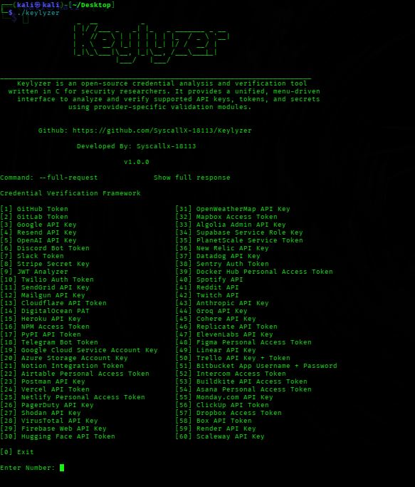

# Keylyzer

**A lightweight API credential validation tool built in C.**

Keylyzer is a command-line tool designed to check API credentials across 60+ services through a single interface. It helps developers quickly determine whether their credentials are accepted by supported services without manually testing each API.

## Features

- **60+ service integrations** for checking API credentials.
- **Fast CLI workflow** for testing credentials from the terminal.
- **C implementation** using libcurl for HTTP requests.
- **Centralized testing** across multiple API providers.
- **JWT analysis** for inspecting token headers and payloads locally.
- **Expandable architecture** for adding more services and validation methods.



## How It Works

Keylyzer sends authentication requests to supported services and interprets their responses to help determine whether the supplied credentials are accepted.

Depending on the provider, results may indicate valid credentials, invalid credentials, insufficient permissions, or an inconclusive response.

> A successful authentication check does not necessarily mean a key has access to every feature or permission offered by a service.

## Why Keylyzer?

Tired of visiting different platforms searching for API endpoints, and writing separate commands to validate your API keys?

**Keylyzer brings API credential testing into one place.**

- **One tool, 60+ integrations:** Check credentials across supported platforms through a single CLI interface.
- **Simple workflow:** No need to manually search for validation commands for every provider.
- **Privacy-focused:** API credentials are used to make authentication requests to the relevant service.
- **No unnecessary storage:** Keylyzer does not intentionally store your API keys or send them to unrelated destinations.

**One interface. Multiple platforms. Simplified validation.**

Keylyzer sends authentication requests to the relevant API provider to check whether credentials are accepted. Your requests necessarily reach the provider being tested, so only use credentials you own or are authorized to test.

## Requirements

- Linux or another supported Unix-like environment

### Install Dependencies

**Debian / Ubuntu / Kali Linux**

```bash
sudo apt update
sudo apt install build-essential make libcurl4-openssl-dev
```

## Build from Source

Clone the repository:

```bash
git clone https://github.com/SyscallX-18113/Keylyzer.git
cd Keylyzer
```

Compile the project:

```bash
make
```

*If your repository uses a different URL or build process, update these commands accordingly.*

## Usage

Run the compiled executable:

```bash
./keylyzer
```

Follow the prompts to select a supported service and provide the corresponding API credential.

**Note:** The exact commands and options depend on the current implementation.

## Supported Services

Keylyzer currently supports **60+ API service integrations**.

The supported-service list will be maintained here as the project evolves.

## Security and Responsible Use

- Test only API credentials you own or are explicitly authorized to assess.
- Keylyzer is intended for legitimate and authorized security testing.

## Next Update v2.0.0

- [ ] Expand coverage to 120+ services.
- [ ] Improve provider-specific response handling.
- [ ] Add deeper API permission and scope analysis.
- [ ] Distinguish authentication failures from authorization failures.
- [ ] Improve error reporting and credential-handling safeguards.

## Contributing

Contributions, bug reports, and suggestions are welcome.

When contributing a new integration, aim for clear error handling, provider-appropriate authentication, minimal permission requirements, and safe handling of credentials.

## License

Keylyzer is licensed under the Apache License 2.0.

Copyright © 2026 Devesh Kachhawaha (SyscallX-18113).
